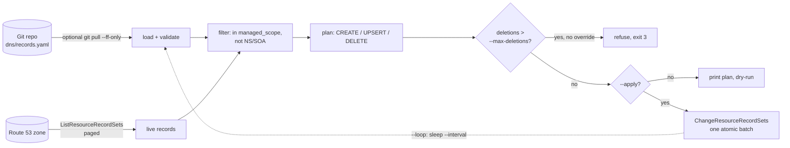

# GitOps DNS reconciler for Route 53

A small Python tool that keeps Route 53 records in line with a YAML file in
Git. It reads the desired records, lists the live ones, prints a plan
(create / update / delete), and applies it as one Route 53 change batch
only when asked. It can run once (cron, CI) or loop forever.

> **Status:** Route 53 is implemented and unit tested against a
> hand-written fake Route 53 client (32 tests) that pages like the real API
> and applies change batches all-or-nothing. Tests cover validation, the
> plan, NS/SOA and scope protection, the deletion guard, apply-then-converge,
> loop mode and `git pull` failure. It has **not** been run against a real
> hosted zone. **Azure DNS is an interface stub** (`AzureDnsProvider` raises
> `NotImplementedError`).

## Problem

> Implement a Go or Python tool that continuously reconciles desired DNS
> records (Route 53 / Azure DNS) from a Git repository (GitOps for DNS).

## How it works



### Desired state (`dns/records.yaml`)

```yaml
zone_id: Z0123456789EXAMPLE
zone_name: example.com.
managed_scope:            # only these names, and names under them, are touched
  - app.example.com.
  - api.example.com.
records:
  - name: app.example.com.
    type: A
    ttl: 300
    values: [192.0.2.10, 192.0.2.11]
```

Validation fails the run (exit 1) when a record is NS or SOA, sits outside
`managed_scope`, is listed twice, has a TTL outside 1..604800, has no
values, is a CNAME with more than one value, or uses an unsupported type.
Names are lowercased and given a trailing dot; value order doesn't matter.

## Safety rules

- **Scope:** only live records whose name equals or ends in a
  `managed_scope` entry are considered. Everything else in the zone is
  invisible to the tool and never changed.
- **NS and SOA are never touched**, even when the scope is the whole zone.
- **Dry-run by default.** Nothing changes without `--apply`.
- **Deletion guard:** if the plan deletes more than `--max-deletions`
  (default 5) records, the tool refuses (exit 3) unless
  `--allow-mass-delete` is given. The guard also trips in dry-run, so a CI
  check shows it before anyone applies.
- **Alias and routing-policy records** (weighted, latency, failover) inside
  the scope stop the run, because the tool can't round-trip them safely.
- **One atomic batch:** Route 53 applies a change batch all or nothing.
  Plans over 1,000 changes are refused rather than split.

## Usage

```bash
python -m pip install -r requirements-dev.txt
python -m ruff check .
python -m ruff format --check .
python -m pytest -q

# Plan only (safe, the default)
python -m dnsrecon --records dns/records.yaml

# Apply
python -m dnsrecon --records dns/records.yaml --apply

# Continuous: pull the repo and reconcile every 5 minutes
python -m dnsrecon --records /srv/dns-repo/dns/records.yaml --git-pull --apply --loop --interval 300
```

| Exit code | Meaning |
|---|---|
| 0 | in sync, dry-run printed, or changes applied |
| 1 | any error: bad YAML, API error, `git pull` failed, Azure selected |
| 3 | deletion guard refused the plan |

### Single run vs loop

- **Single run** fits cron or a CI job on merge to main (the CI job is
  then the "continuous" part).
- **`--loop`** runs forever with `--interval` seconds between runs. Any
  error stops the process with exit 1, on purpose: run it under systemd
  (`Restart=on-failure`) or as a Kubernetes Deployment so it is restarted
  and the failure is visible, instead of retrying silently.

Permissions needed: `route53:ListResourceRecordSets` and
`route53:ChangeResourceRecordSets` on the one hosted zone.

## Limits

- Route 53 only; Azure DNS is a stub.
- Simple records only (A, AAAA, CNAME, TXT, MX, SRV, CAA). No alias or
  routing-policy records.
- One hosted zone per records file.
- The tool does not wait for the change to reach `INSYNC`; it prints the
  change ID.
- TXT values must be written with their quotes, as Route 53 stores them.
- Two reconcilers on the same zone would fight; run one.

## Security notes

- No credentials in code or config; boto3 uses the standard chain.
- Git is the audit trail: every DNS change should come from a reviewed
  commit. `--git-pull` only fast-forwards, so a rewritten branch stops the
  run instead of being applied.
- Give the runtime role access to one hosted zone, not `*`.

## Idempotency

Reconciling is idempotent by design: the plan is the difference between Git
and Route 53, so a second run after a successful apply prints `in sync`
and sends nothing. A test applies a plan with the fake client and checks
that the next run is empty.

## Layout

```
dnsrecon/records.py     YAML loading, validation, name normalising
dnsrecon/providers.py   Route 53 (paged list, atomic apply), Azure stub
dnsrecon/plan.py        scope/NS/SOA filter and the diff
dnsrecon/cli.py         dry-run, --apply, guard, --loop, --git-pull
dns/records.yaml        example desired state (placeholder zone)
```
